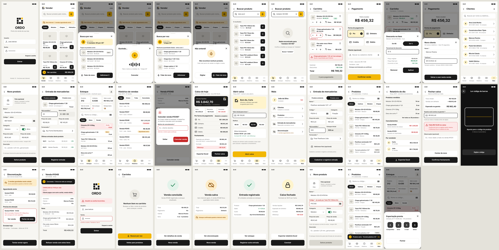

# ORDO — PDV mobile

Ponto de venda para Android (Expo + Supabase), começando por uma loja de ferragens. Venda rápida com busca por texto e voz, estoque centralizado, caixa e relatório diário, funcionando sem internet.



## Comece por aqui
- **[SPEC.md](SPEC.md)**: especificação completa para implementar (pessoas e IA).
- **[docs/figma/](docs/figma/)**: as 37 telas exportadas do Figma (PNG e SVG).
- **[docs/requisitos-v2.0.md](docs/requisitos-v2.0.md)**: requisitos do cliente.
- **[AGENTS.md](AGENTS.md)**: regras para agentes de IA (Claude Code, Codex, Cursor…).

## Rodar
```bash
npm install
npx expo start            # sem .env roda em modo demonstração (qualquer login entra)
npm run typecheck && npm test
```
Configuração do Supabase, voz e câmera: SPEC §3.

## O que já está pronto
- Projeto Expo SDK 58 + Expo Router com **todas as rotas** das telas, trava de login e abas.
- Design system em código (tokens + 18 componentes) idêntico ao Figma; ícone e splash a partir do logo.
- Fluxo de venda completo de referência: login → vender (grade, categorias, voz) → carrinho (desconto por item, bloqueio por estoque) → pagamento (cliente rápido) → venda concluída / salva offline.
- Banco Supabase: tabelas, RLS, funções de venda, cancelamento, entrada, caixa e relatório, testadas em PostgreSQL 16 (inclui venda simultânea da última unidade).
- Fila offline com sincronização automática e idempotente.
- Testes: interpretação da voz e cálculo do carrinho (`npm test`), regras do banco (`supabase/tests/rpc_test.sql`).

O restante está organizado em 14 issues no SPEC §12, com um prompt pronto por issue em [`docs/prompts/`](docs/prompts/).
